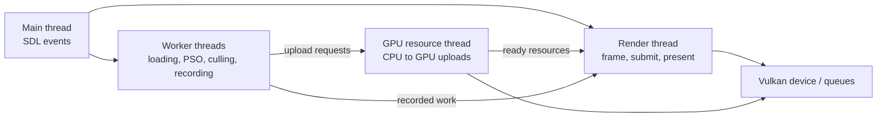

# Ocarina Vulkan

## About

**Ocarina Vulkan** is a personal Vulkan rendering engine and learning sandbox. It focuses on practical rendering systems: swapchains and offscreen passes, descriptor sets, pipeline state, bindless textures, GPU upload synchronization, and multithreaded frame execution. It is intended for experimentation rather than production use.

The project uses Vulkan, SDL3, enkiTS, Dear ImGui, DXC/SPIRV-Cross, EASTL, and Tracy (optional).

## Multithreaded rendering

enkiTS provides a small set of dedicated threads plus worker jobs. Thread 0 is normally the thread that creates the renderer.

- **Main thread** — application setup and the SDL event loop.
- **Render thread** — runs the frame loop, submits graphics work, and presents.
- **GPU resource thread** — serializes queued GPU uploads such as mesh and texture data.
- **Worker threads** — perform asynchronous loading, pipeline compilation, culling, and command-buffer recording jobs.



The renderer begins presenting immediately. While background work is still pending, it can render the loading UI; resources become visible to draws only after their GPU upload has completed.

## Building

**Requirements:** CMake 3.x, Visual Studio 2022 or another C++20 toolchain, and the Vulkan SDK.

```bash
cmake -B build -G "Visual Studio 17 2022"
cmake --build build --config Debug --target test-vulkan-triangle
```

Binaries are written to `bin/Debug/` or `bin/Release/`. Run them from the repository root so paths under `res/` resolve correctly.

### Tracy profiler

Tracy is available as an optional submodule at `src/ext/tracy`.

```bash
git submodule update --init src/ext/tracy
cmake -B build -DOCARINA_ENABLE_TRACY=ON
cmake --build build --config Debug --target test-vulkan-triangle
```

Connect the [Tracy desktop app](https://github.com/wolfpld/tracy/releases) to a running test. Instrumentation helpers are available in `core/profiler.h`.

## Test targets

| Target | Description |
|---|---|
| `test-vulkan-triangle` | Minimal Vulkan triangle and swapchain presentation. |
| `test-vulkan-offscreen` | Offscreen render target followed by presentation to the swapchain. |
| `test-vulkan-texture` | Textured quad rendering. |
| `test-vulkan-bindless` | Bindless texture sampling. |
| `test-enkiTS` | Basic enkiTS task scheduler and pinned-task behavior. |
| `test-asyncLoadGLTF` | Asynchronous scene-loading and rendering integration test. |
| `test-culling` | Parallel frustum-culling path. |
| `test-indirect-rendering` | GPU-driven indirect rendering of a large cube grid. |
| `test-skybox` | Cubemap skybox rendering. |
| `test-computeshader` | Compute pass writing data consumed by a display pass. |
| `test-pbr` | Image-based-lighting PBR rendering with skybox support. |
| `test-alphablendmode` | Opaque, masked, and transparent material blend modes. |

## Project notes

- Rendering passes are organized into explicit `PassGroupId` groups. Register passes in the order they must execute; a full frame graph is not present yet.
- Resource readiness matters: asynchronous meshes and textures may be skipped for a frame rather than stalling rendering.
- Vulkan object lifetime is frame-sensitive. Keep resources alive until submitted GPU work that references them has completed.
